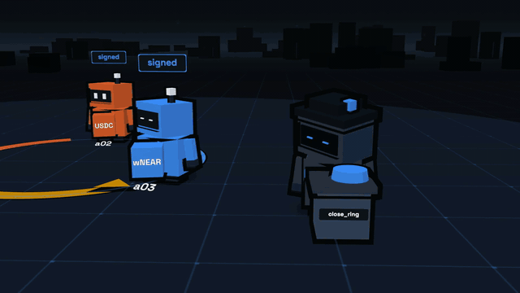
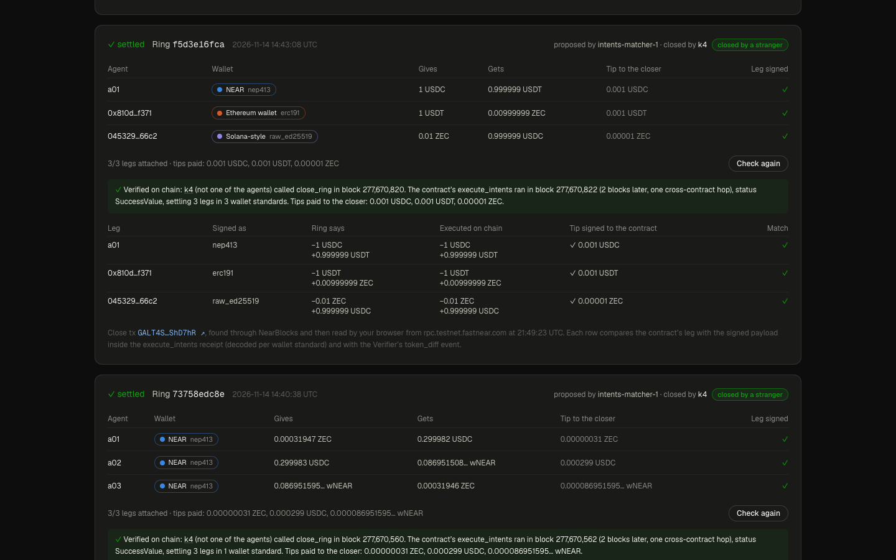
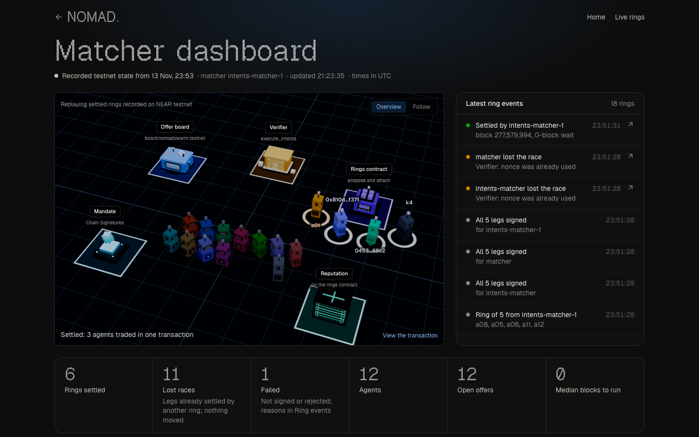
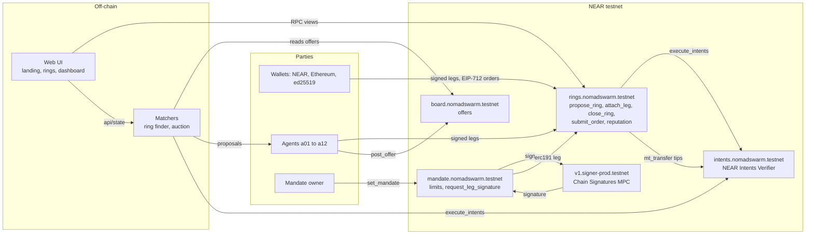
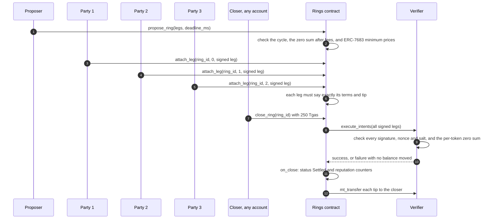
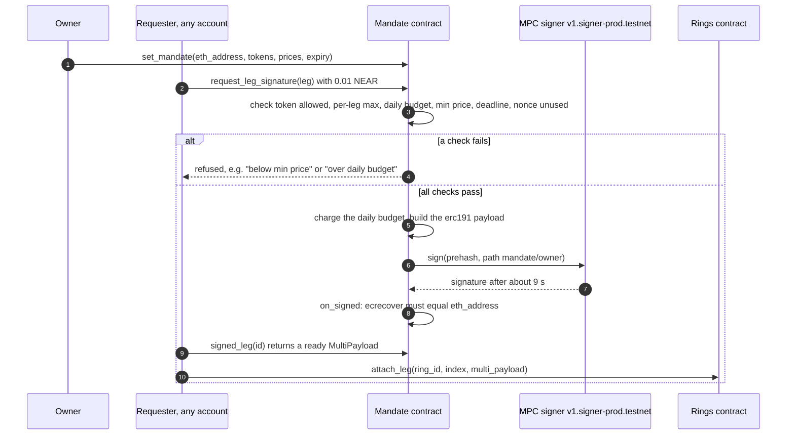
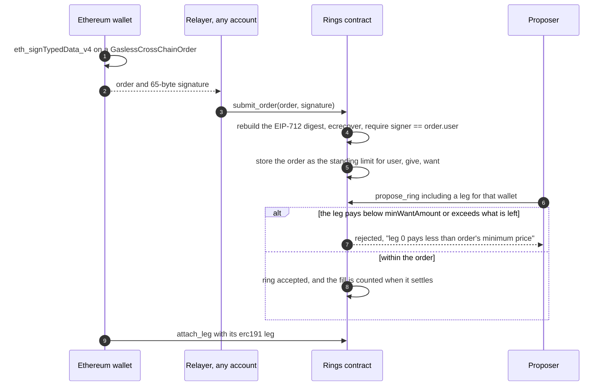
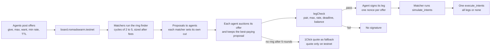

<p align="center">
  
</p>

# Nomad

**Agents and wallets trade in rings that settle atomically on NEAR Intents. Each one signs only its own leg, and anyone can close the ring.**

[](media/nomad-teaser.mp4)

Watch it [with sound](media/nomad-teaser.mp4), or on X: https://x.com/sigma_coder12/status/2121733003345027462

Tracks: **AI Swarms** and **DeFi**. Network: **NEAR testnet**. Live site: **https://nomad.charlesms.dev**. One keyless check: **`make demo`**.

| 27 rings settled, 0 failed | 3 wallet standards | 0 access keys | Same code hash as mainnet | 125 TS + 70 Rust tests |
|---|---|---|---|---|
| in a 36-minute live run with 12 agents | `nep413`, `erc191` and `raw_ed25519` legs settled in one ring | on the rings and mandate contracts | our Verifier runs `intents.near`'s exact wasm | `make test`, and in CI on every push |

## Why it matters

- **Parties trade with each other, with no solver in the middle.** Each leg carries the price its party signed. In on-chain closing, the only payment is the tip each party signs to whoever closes the ring, which was 0.1% in our runs.
- **Settlement is atomic across many parties.** 2 to 5 wallets settle in one `execute_intents` call. Every leg executes or none does, and no escrow holds anyone's funds.
- **It works with any wallet, and with agents under on-chain limits.** NEAR keys, Ethereum keys (including EIP-712 orders) and ed25519 keys can trade in one ring. An agent can trade from an Ethereum address that a contract controls through Chain Signatures. That address has no private key, and every leg is checked against the owner's limits before it is signed.

## Why NEAR

NEAR Intents' `execute_intents` accepts intents signed by many accounts under different wallet standards and commits them all or none. That one call is Nomad's whole settlement layer. On testnet it settled a ring of `nep413`, `erc191` and `raw_ed25519` legs in [`GALT4S7B…`](https://testnet.nearblocks.io/txns/GALT4S7BiENHVroypTv1uQmanBAmhm9uSXbyHpShD7hR). NEAR Chain Signatures let `mandate.nomadswarm.testnet` own an Ethereum address with no private key and sign legs for it only after on-chain checks. A leg signed that way settled in [`2WgJbhRW…`](https://testnet.nearblocks.io/txns/2WgJbhRWZJhy38nCxSLeb2FPXCN4SaX9TmvhakBcPrr9). Cross-contract calls let the rings contract settle a ring for any caller and pay that caller the tips in the same flow.

## The problem

A swap usually goes through a market maker or a solver, who takes the other side of the trade and charges a spread for it. Often the opposite trade already exists, but not as a pair. Someone holds USDC and wants USDT. A second person holds USDT and wants ZEC. A third holds ZEC and wants USDC. No two of them can trade directly with each other, so each of them goes to an intermediary.

Settling all three trades together is also hard. If one party backs out halfway, the others are left holding the wrong tokens. Two usual fixes are an escrow contract that holds everyone's funds, or one operator that everyone trusts.

## How Nomad solves it

Nomad treats the three trades as one **ring**. Each party signs only its own **leg** ("I give X of token A and receive at least Y of token B"). The NEAR Intents Verifier then settles all the legs in **one `execute_intents` call**. The Verifier checks every signature and checks that every token nets to zero, so either every leg settles or none does. No escrow holds the funds, and no party has to trust the others.

A real example is ring `f5d3e16f…` on testnet, settled in [`GALT4S7B…`](https://testnet.nearblocks.io/txns/GALT4S7BiENHVroypTv1uQmanBAmhm9uSXbyHpShD7hR). All amounts are in the tokens' smallest units.

| Party | Wallet standard | Gives | Receives | Tip to the closer |
|---|---|---|---|---|
| `a01.nomadswarm.testnet` | `nep413` (NEAR key) | 1,000,000 USDC | 999,999 USDT | 1,000 USDC |
| `0x810d…` (fresh Ethereum key) | `erc191` | 1,000,000 USDT | 999,999 ZEC | 1,000 USDT |
| `045329…` (fresh ed25519 key) | `raw_ed25519` | 1,000,000 ZEC | 999,999 USDC | 1,000 ZEC |

Each party receives 1 unit less than the next party gives. That unit is the Verifier's fee of 1 pip (one millionth), rounded up. With that unit deducted, every token nets to exactly zero. The ring was proposed on the Nomad rings contract, and each party attached its signed leg. Then `k4.nomadswarm.testnet`, an account with no part in the ring, called `close_ring`. The contract made the `execute_intents` call, and the three tips went to `k4`.

Around this, Nomad adds:
- **Permissionless close.** Anyone can propose a ring, attach a signed leg, or close a fully signed ring and collect its tips. Nobody needs an allowlist, and no matcher takes a cut.
- **Any wallet.** One ring can mix NEAR keys, Ethereum keys and raw ed25519 (Solana-style) keys.
- **ERC-7683 orders.** An Ethereum wallet signs one EIP-712 order. The contract enforces the order's minimum price on every ring that includes that wallet.
- **On-chain mandates.** A contract signs legs for an agent through NEAR Chain Signatures, and only within limits that the owner sets. Nobody holds a private key for that agent's address.
- **Reputation.** The contract counts the rings each account settled, the rings it closed and its legs in failed closes.
- **One-of-N commitments.** A party may sign legs for several competing rings that all fill the same offer. All of them share one Verifier nonce, so at most one can ever execute.
- **An agent swarm.** Twelve agents post offers. Matchers find rings, and the agents auction their legs between the matchers on price.

## Try it

### Quick check: `make demo`

On a fresh clone, with Node 20+ and pnpm 9 (`corepack enable`), and with no keys:

```sh
git clone https://github.com/charlesms1246/nomad.git && cd nomad && make demo
```

It installs, builds and runs four checks in about 10 seconds after the install. Trimmed output:

```
== 1/4 make sim: 20 agents, 5 tokens, no chain. See: rings settled, share of offers cleared by rings
sim backend=ledger (7 ms) agents=20 tokens=5 seed=1 rounds=30: settled 11 rings (k=2:5 k=3:3 k=4:2 k=5:1), cleared 47% of offers by rings (18/38), 53% fell back to 1Click; ... failed rings 0
== 2/4 make dry-run: signed 3/4/5-party rings through simulate_intents on our testnet Verifier (read-only). See: k+1 intents_executed
ring-3.json: simulate_intents on intents.nomadswarm.testnet: 4 intents_executed (3 agents + matcher)
ring-4.json: simulate_intents on intents.nomadswarm.testnet: 5 intents_executed (4 agents + matcher)
ring-5.json: simulate_intents on intents.nomadswarm.testnet: 6 intents_executed (5 agents + matcher)
== 3/4 make mainnet-proof: a Nomad-signed ring through simulate_intents on MAINNET intents.near (read-only). See: signatures pass, stops at the balance check
ring (3 agents), leg 1 first: insufficient balance or overflow
control: corrupted signature: invalid signature
control: zero salt: invalid salt
PASS: for each of the 3 agents' legs ..., mainnet intents.near accepts Nomad's NEP-413 signature, versioned nonce and salt and stops only at the balance check ...
== 4/4 on-chain check of ring f5d3e16f (3 wallet standards, closed by a stranger), read from testnet RPC. See: PASS lines
PASS  status Settled, closer k4.nomadswarm.testnet
PASS  closed by k4.nomadswarm.testnet, which is not one of the ring's 3 parties
PASS  tx GALT4S7B… is k4.nomadswarm.testnet -> rings.nomadswarm.testnet.close_ring({ring_id: f5d3e16f…})
PASS  intents.nomadswarm.testnet executed execute_intents successfully
PASS  3 token_diff events for 3 legs
PASS  leg 0 (nep413): executed diff equals the signed spec -1000000/+999999
PASS  leg 1 (erc191): executed diff equals the signed spec -1000000/+999999
PASS  leg 2 (raw_ed25519): executed diff equals the signed spec -1000000/+999999
PASS  tip 1000 usdc paid to the closer
PASS  intents.nomadswarm.testnet code hash BtA1BEFNS619KkvXFsgcpQ21Tb5yMm32aaUkn7xNothk = mainnet intents.near
PASS: ring settled atomically on testnet, closed by a non-party, every leg executed exactly as signed
demo: all four checks passed. No keys used, no transactions sent.
```

The on-chain check is [scripts/check-ring.ts](scripts/check-ring.ts). It reads the ring from the rings contract and fetches the close transaction from an archival RPC. It checks that the transaction is `close_ring` from a non-party, and that each executed `token_diff` equals the leg that was signed. It also checks that each tip reached the closer and that the Verifier's code hash equals mainnet's.

### In the browser, in 5 minutes

All you need is a browser. `/` and `/rings` read NEAR testnet live, `/dashboard` replays recorded testnet data, and no page can move funds.

1. **Watch a ring settle.** Open https://nomad.charlesms.dev and scroll to **One ring, start to finish**. It replays a real three-wallet ring step by step, from proposal to tips, with links to the real transactions.
2. **Verify every ring.** Open https://nomad.charlesms.dev/rings?verify=1. Each closed ring gets a green **Verified on chain** box once your browser has re-checked it against the Verifier.
3. **See the agents.** Open https://nomad.charlesms.dev/dashboard to watch the agents trade in rings, replayed from recorded testnet data.
4. **Check one transaction.** Open [`GALT4S7B…`](https://testnet.nearblocks.io/txns/GALT4S7BiENHVroypTv1uQmanBAmhm9uSXbyHpShD7hR) on NearBlocks. `k4` calls `close_ring`, one `execute_intents` settles all three legs, and the tips go to `k4`.





## How it works

### System architecture



### One ring, start to finish



`propose_ring` refuses a ring that is not a cycle, has more than 5 legs, or does not net to zero after the fee. It also refuses a ring that breaks a live ERC-7683 order. `attach_leg` parses each signed message and refuses it unless it contains exactly one `token_diff` with this leg's amounts, signed by this leg's party, and the agreed tip to the rings contract. The Verifier checks the signatures themselves at close. If a close fails, nothing moves, the ring returns to a closable state, and every party in it gets one more failed close on its reputation.

### Mandates: an agent with limits and no hot key



The mandate's Ethereum-style address (`0x9915…bf9b`) is derived by Chain Signatures from the mandate contract's account and the path `mandate/<owner>`. No private key for it exists, so the only way to get a leg signed for that address is through these checks.

### ERC-7683 orders from Ethereum wallets



The order uses the `GaslessCrossChainOrder` struct from the earlier ERC-7683 draft. The EIP-712 domain is `name "Nomad"`, `version "1"`, `chainId 398` (NEAR testnet in the EIP-155 registry) and `verifyingContract 0x0`. `orderData` is `abi.encode(string give, uint256 giveAmount, string want, uint256 minWantAmount)`. The TypeScript signer (`packages/intents/src/erc7683.ts`) and the Rust verifier share a golden vector, which was also checked against viem.

### Off-chain swarm mode



In this mode the matcher adds its own fee leg to the batch. Matchers compete on that fee, because each agent signs only the best-paying proposal in its auction window.

## Feature → code → test

`make test` runs every test named here except the live ones, and CI runs `make test` on every push. Rust test names are functions in `contracts/<name>/src/tests.rs`.

| Feature | Code | Test |
|---|---|---|
| Ring checks: a 2–5 cycle, every token nets to zero after the fee | `check_ring`, `propose_ring` in [contracts/rings/src/lib.rs](contracts/rings/src/lib.rs) | `a_valid_ring_passes_and_needs_no_matcher_leg`, `rejects_exact_zero_sum_without_fee`, `rejects_non_cycles_duplicates_and_bad_sizes`, `fee_is_a_ceiling` |
| A leg must commit to exactly its spec, in any wallet standard | `check_leg_message`, `attach_leg` in [contracts/rings/src/lib.rs](contracts/rings/src/lib.rs) | `propose_attach_any_standard`, `rejects_a_leg_with_the_wrong_amount`, `rejects_a_leg_signed_by_someone_else`, `rejects_tips_to_anyone_but_this_contract_and_extra_intents` |
| Permissionless close, tips to the closer, reputation | `close_ring`, `on_close`, `apply_outcome`, `register_agent` in [contracts/rings/src/lib.rs](contracts/rings/src/lib.rs) | `close_needs_every_leg`, `settlement_pays_tips_to_the_closer_and_writes_reputation`, `a_failed_close_moves_nothing_and_counts_against_the_ring`, `identity_registration`. On chain: [scripts/check-ring.ts](scripts/check-ring.ts) (`make demo`) |
| ERC-7683 orders: EIP-712 digest, `ecrecover`, minimum price enforced | [contracts/rings/src/order.rs](contracts/rings/src/order.rs), `submit_order`; signer [packages/intents/src/erc7683.ts](packages/intents/src/erc7683.ts) | `erc7683_order_data_and_digest_match_the_ts_vector`, `erc7683_ecrecover_finds_the_signer`, `submit_order_then_a_ring_below_the_order_price_is_rejected`; [erc7683.test.ts](packages/intents/test/erc7683.test.ts) with the shared [golden vector](packages/intents/test/fixtures/erc7683-vector.json) |
| Mandate limits (tokens, per-leg max, daily budget, minimum price) and MPC signing | [contracts/mandate/src/lib.rs](contracts/mandate/src/lib.rs) | `accepts_a_good_leg`, `rejects_each_rule`, `daily_budget_accounting`, `nonce_reuse_and_budget_rejected`, `request_sign_callback_roundtrip`, `failed_or_foreign_signature_refunds_budget`, `revoked_mandate_cannot_sign`, `erc191_prehash_known_vector` |
| `nep413` signing and versioned nonces | [packages/intents/src/nep413.ts](packages/intents/src/nep413.ts), [nonce.ts](packages/intents/src/nonce.ts) | [intents.test.ts](packages/intents/test/intents.test.ts) (golden vector, cross-checked against `node:crypto`) |
| `erc191` and `raw_ed25519` signing | [packages/intents/src/standards.ts](packages/intents/src/standards.ts) | [standards.test.ts](packages/intents/test/standards.test.ts) |
| One-of-N commitments: one nonce per offer, rotated after `nonce was already used` | [apps/agent/src/runtime.ts](apps/agent/src/runtime.ts) | [race.test.ts](apps/matcher/test/race.test.ts), [race2.test.ts](apps/matcher/test/race2.test.ts); attack A7 on chain |
| Ring finder: cycle search, fee-correct sizing, surplus split | [packages/ringfinder/src/index.ts](packages/ringfinder/src/index.ts) | [ringfinder.test.ts](packages/ringfinder/test/ringfinder.test.ts) (property tests) |
| `legCheck`: an agent never signs outside its offer | [apps/agent/src/legCheck.ts](apps/agent/src/legCheck.ts) | [legCheck.test.ts](apps/agent/test/legCheck.test.ts), [legCheck.prop.test.ts](apps/agent/test/legCheck.prop.test.ts) (fast-check through the real signing path) |
| Fee auction: matchers compete on their cut | `onProposalAsync` in [apps/agent/src/runtime.ts](apps/agent/src/runtime.ts) | [fee-competition.test.ts](apps/matcher/test/fee-competition.test.ts) |
| Matcher loop: propose, collect, simulate, execute | [apps/matcher/src/matcher.ts](apps/matcher/src/matcher.ts) | [matcher.test.ts](apps/matcher/test/matcher.test.ts) |
| Local Verifier model | [packages/verifier-model/src/index.ts](packages/verifier-model/src/index.ts) | [model.test.ts](packages/verifier-model/test/model.test.ts); [differential.live.ts](packages/verifier-model/test/differential.live.ts) against testnet (live, not in `make test`) |
| Offer board | [contracts/board/src/lib.rs](contracts/board/src/lib.rs) | 40 tests in [contracts/board/src/tests.rs](contracts/board/src/tests.rs) |
| 1Click baseline, with the fallback refused on testnet | [packages/oneclick/src/fallback.ts](packages/oneclick/src/fallback.ts) | [fallback.test.ts](packages/oneclick/test/fallback.test.ts) |
| Signatures accepted by mainnet `intents.near` | [scripts/mainnet-simulate.ts](scripts/mainnet-simulate.ts) | `make mainnet-proof` (read-only) |
| `/rings?verify=1`: re-checks every close on chain in the browser | [web/components/OnchainRings.tsx](web/components/OnchainRings.tsx) | No unit test. [scripts/check-ring.ts](scripts/check-ring.ts) runs the same checks from the command line. `make ui-check` screenshots |
| Landing ring replay | [web/components/landing/RingReplay.tsx](web/components/landing/RingReplay.tsx) | `make ui-check` screenshots |

## Proof on testnet

Every link goes to NearBlocks.

| What | Tx |
|---|---|
| A stranger (`k4`, not a party to the ring) closes a ring whose legs use three wallet standards (`nep413` + `erc191` + `raw_ed25519`). Each wallet gave 1,000,000 plus a 1,000 tip and received 999,999. The closer received the three tips | [`GALT4S7B…`](https://testnet.nearblocks.io/txns/GALT4S7BiENHVroypTv1uQmanBAmhm9uSXbyHpShD7hR) |
| A stranger closes a three-agent ring. One cross-contract `execute_intents` call settles it, and the closer receives exactly the three tips | [`85Emngj6…`](https://testnet.nearblocks.io/txns/85Emngj6B4q8EqSjAWShfPbMYSfrGstE9RnYJwrhVQdc) |
| An ERC-7683 order from a fresh Ethereum wallet is checked on chain | [`DGMvefCs…`](https://testnet.nearblocks.io/txns/DGMvefCsuZuuzoSs6iqqkkMFjpGYhPPnAjAab1VzgkhV) |
| A ring that pays that wallet less than its minimum price is rejected | [`GvZcdEY5…`](https://testnet.nearblocks.io/txns/GvZcdEY5LPHfxxJ6M67ijEyVPhAbwE9ZrFdAZaLHXzFF) |
| A ring at the order's price settles, and the order shows 399,495 of 1,000,000 filled | [`D6YZJqgr…`](https://testnet.nearblocks.io/txns/D6YZJqgrEVXXNVLahodBycyBBqNV1RnwnY6ptAyCRhCK) |
| A leg signed by the mandate through Chain Signatures settles in a ring that a stranger closed. The MPC request ([`J89CLaPP…`](https://testnet.nearblocks.io/txns/J89CLaPPRsbuQ4nNqXTqdNXJnXu8GmzZcvjFWxqUkW7A)) took 9.2 s | [`2WgJbhRW…`](https://testnet.nearblocks.io/txns/2WgJbhRWZJhy38nCxSLeb2FPXCN4SaX9TmvhakBcPrr9) |
| The mandate refuses a leg below its minimum price: `mandate: below min price: get 90000 for give 100000 < 99/100` | [`GJXuiUZF…`](https://testnet.nearblocks.io/txns/GJXuiUZF1HvDVbCjMp49fDRhrK8JLYAj5LMmJrNSbPUg) |
| The mandate refuses a leg over its daily budget: `over daily budget: spent 400200 + 160000 > 550100` | [`Ht9SdVao…`](https://testnet.nearblocks.io/txns/Ht9SdVaozyEKSoYtAU398TVNaZM7JfEUe6rcvQhQk8DU) |
| The three wallet standards settle together directly through `execute_intents` | [`EpaBq8dN…`](https://testnet.nearblocks.io/txns/EpaBq8dN8WhojK4eo1fqZ7XRBMXuGBdjv4G8bu5r379x) |
| A 36-minute live swarm run with 12 agents: **27 rings settled, 0 failed** (k = 3: 4, k = 4: 17, k = 5: 6), at about 15.1 Tgas per ring | [`Fd5Q86nQ…`](https://testnet.nearblocks.io/txns/Fd5Q86nQS8qmn4aQz7of5vXXUx86sscwNpFa5J1sPoCw) (k = 4), [`EqLHddfT…`](https://testnet.nearblocks.io/txns/EqLHddfTmLVHUVgE5MUZcfgT56SfLCWSr4nBFdWSPso3) (k = 5) |
| A fee race: three matchers propose on the same rings. The 5% matcher won all 7 settled rounds | [`9jZc4meP…`](https://testnet.nearblocks.io/txns/9jZc4meP5XmsexNNDQ1oav18AsX3AuxxVR4xtPYdzrxH) |
| A three-agent ring settles in one receipt, burning 11.36 Tgas | [`BgjzT1Va…`](https://testnet.nearblocks.io/txns/BgjzT1VayBzmvfuqx29pmBnj1tzS1M7hxkXJ3sigVRKE) |

### Attacks, each submitted for real

`scripts/attacks.ts` submits each attack as a real `execute_intents` call, not only as a simulation. A row passes only if the batch fails with the expected error and none of the balances it watches moves. All rows pass.

| Attack | Verifier error | Tx |
|---|---|---|
| A party spends its balance before settlement | `insufficient balance or overflow` | [`DzrAU1T9…`](https://testnet.nearblocks.io/txns/DzrAU1T9x7AzDtR627PYM6ZwkVkWLQG6nASP7rLxTG6e) |
| The submitter inflates its own leg | `invariant violated` | [`73Loxt2m…`](https://testnet.nearblocks.io/txns/73Loxt2m5bqMCMcdcLoKeDc6LFNLfrBco9QipALs9vbq) |
| The submitter alters a signed leg | `invalid signature` | [`6AkUyrhB…`](https://testnet.nearblocks.io/txns/6AkUyrhBd1FdXmfNyuvsFeCtwoLapzM7YZLJBjBiJJu5) |
| Legs that already settled are replayed | `nonce was already used` | [`BMGqwEJM…`](https://testnet.nearblocks.io/txns/BMGqwEJMrWqvopvNZHhTLDHQkdWK2dFGmihFzrPnHcCL) |
| A stale salt / a zero salt | `invalid salt` | [`Hz66pPd2…`](https://testnet.nearblocks.io/txns/Hz66pPd2YyKSNV1w4f2D8TsPfsAxf5smfQpUNbHLZW7M), [`76zPf4fS…`](https://testnet.nearblocks.io/txns/76zPf4fS1nUiWQbb5AQGcFD84Rb9tZKeAPeKQucXXL3G) |
| A leg with a zero amount | `invalid intent` | [`77LKZyzq…`](https://testnet.nearblocks.io/txns/77LKZyzqjMRKdjqKyE7AFYJWpRaJe2bQbuRUG5PNeCo1) |
| Two rings race for one offer that has one shared nonce | The loser fails with `nonce was already used` | [`FRZFAP9F…`](https://testnet.nearblocks.io/txns/FRZFAP9FRzdWru41cfJw9jgC7SYwugnWHZMxSmRR4PVs) |

In a three-way race of matchers, all 54 losing batches failed with `nonce was already used`, and none of them moved a balance.

### Our testnet Verifier is mainnet's exact code

`intents.near` exists only on mainnet. Our Verifier, `intents.nomadswarm.testnet`, runs the same wasm as mainnet `intents.near`, and its FullAccess key has been deleted. You can compare the two code hashes yourself:

```sh
curl -s https://rpc.mainnet.fastnear.com -H 'content-type: application/json' -d '{"jsonrpc":"2.0","id":1,"method":"query","params":{"request_type":"view_account","finality":"final","account_id":"intents.near"}}' | grep -o '"code_hash":"[^"]*"'
curl -s https://rpc.testnet.fastnear.com -H 'content-type: application/json' -d '{"jsonrpc":"2.0","id":1,"method":"query","params":{"request_type":"view_account","finality":"final","account_id":"intents.nomadswarm.testnet"}}' | grep -o '"code_hash":"[^"]*"'
```

Both commands print `"code_hash":"BtA1BEFNS619KkvXFsgcpQ21Tb5yMm32aaUkn7xNothk"`.

### Kill tests

Kill tests K1–K8 (`make kill-tests`, needs our keys) pin down the Verifier behaviour that Nomad depends on:
- one receipt per ring;
- the fee rule `ceil(|d|·fee/1e6)`;
- gas of about 3.25 + 2.53 Tgas per signer;
- the 1-yocto `add_public_key`;
- how deposits are routed, deadlines and salts.

K7 also showed that only a transaction signed by the Verifier account itself executes in the block it lands in. Every other submitter waits 1 block, whichever shard it is on.

## Reproduce locally

The commands in this section need no NEAR keys and no funds. Everything below was run on a fresh `git clone` on 2026-11-14, and the outputs are trimmed copies of what it printed.

**Prerequisites**
- Node.js 20 or later (tested with 22.23).
- pnpm 9. The repo pins `pnpm@9.15.0`, so `corepack enable` selects it.
- Rust with `cargo`, for the contract tests (tested with cargo 1.96).
- `curl`, for the RPC checks.

**Clone and install**

```sh
git clone https://github.com/charlesms1246/nomad.git && cd nomad
corepack enable
pnpm install
```

On a fresh clone, `pnpm install` prints 8 `WARN Failed to create bin … dist/…` lines, because the packages aren't built yet. They are harmless: every `make` target builds the packages first.

**`make test`** runs every TypeScript test (live-network tests are skipped), then the Rust tests of the three contracts:

```
packages/colo test:          Tests  17 passed | 2 skipped (19)
packages/oneclick test:      Tests  21 passed | 2 skipped (23)
packages/ringfinder test:    Tests  13 passed (13)
packages/intents test:       Tests  28 passed (28)
packages/verifier-model test: Tests  7 passed (7)
apps/agent test:             Tests  29 passed (29)
apps/matcher test:           Tests  10 passed (10)
test result: ok. 40 passed; 0 failed     # contracts/board
test result: ok. 16 passed; 0 failed     # contracts/rings, including the ERC-7683 golden vector and ecrecover
test result: ok. 14 passed; 0 failed     # contracts/mandate
```

**`make sim`** runs a seeded swarm with no chain: 20 agents, 5 tokens, 30 rounds. It is followed by a sweep over swarm sizes and writes `out/clearing-rate.svg` and `out/ring-lengths.svg`:

```
sim backend=ledger (7 ms) agents=20 tokens=5 seed=1 rounds=30: settled 11 rings (k=2:5 k=3:3 k=4:2 k=5:1), cleared 47% of offers by rings (18/38), 53% fell back to 1Click; agents' mean rate vs mid -18.3 bps vs 1Click baseline -49 bps => saved 30.7 bps; failed rings 0
  sweep tokens=5 agents=10: clearing 49.7%, rings 6
  sweep tokens=5 agents=50: clearing 49.6%, rings 34
  sweep tokens=5 agents=200: clearing 43.9%, rings 154
```

The sim's offers are random, so these figures describe the mechanism, not real demand. The "saved" figure is measured against a 1Click quote that includes its 20 bps keyless app fee. `SIM_BACKEND=model make sim` runs the same sim on the local Verifier model, with real ed25519 signatures.

**`make dry-run`** sends committed, signed ring fixtures through the read-only `simulate_intents` on our testnet Verifier:

```
ring-3.json: simulate_intents on intents.nomadswarm.testnet: 4 intents_executed (3 agents + matcher)
  legs: fx01 -26169 zec +249601 usdc | fx02 -249602 usdc +70334533982086921057068 wnear | fx03 -70334604316691237748306 wnear +26011 zec
  4 token_diff events, fee 1 pips, salt 672865c1
ring-4.json: simulate_intents on intents.nomadswarm.testnet: 5 intents_executed (4 agents + matcher)
ring-5.json: simulate_intents on intents.nomadswarm.testnet: 6 intents_executed (5 agents + matcher)
```

**`make mainnet-proof`** signs a three-party ring for **mainnet** `intents.near` and runs it through the read-only `simulate_intents`. No transaction is sent. It rotates the ring so that each leg is checked first once:

```
ring (3 agents), leg 1 first: insufficient balance or overflow
ring (3 agents), leg 2 first: insufficient balance or overflow
ring (3 agents), leg 3 first: insufficient balance or overflow
control: corrupted signature: invalid signature
control: zero salt: invalid salt
PASS: for each of the 3 agents' legs (each run once in first position), mainnet intents.near accepts Nomad's NEP-413 signature, versioned nonce and salt and stops only at the balance check (the implicit accounts are unfunded). ...
```

**The web UI**

```sh
cd web && npm install && npm run dev
```

Then open:
- http://localhost:3000 for the ring replay;
- http://localhost:3000/rings?verify=1 for the on-chain rings, re-checked as the page loads;
- http://localhost:3000/dashboard for the swarm view, playing back recorded testnet data unless `MATCHER_URL` points to a running matcher. `make sim-serve` in another terminal serves a live simulation, which the page labels Simulation.

`make ui-check` (stop any running `web/` dev server first) starts a sim matcher and the dev UI. It then saves headless screenshots to `out/ui-check/`: `/` and `/rings` at 1440 px and 390 px, and `/dashboard` at 1440 px.

**Read the contracts with no tools but `curl`**

```sh
# rings contract config: {"owner":"nomadswarm.testnet","verifier":"intents.nomadswarm.testnet","fee_pips":1,"rings":5,"settled":4,"eip712_chain_id":398}
curl -s https://rpc.testnet.fastnear.com -H 'content-type: application/json' \
  -d '{"jsonrpc":"2.0","id":1,"method":"query","params":{"request_type":"call_function","finality":"final","account_id":"rings.nomadswarm.testnet","method_name":"config","args_base64":"e30="}}' \
  | python3 -c 'import sys,json; print(bytes(json.load(sys.stdin)["result"]["result"]).decode())'
```

Change `method_name` and `args_base64` (base64 of the JSON args) to call any view in the [Contract API](#contract-api). For example, `rings` with `{"from":0,"limit":5}` (`eyJmcm9tIjowLCJsaW1pdCI6NX0=`) returns the five newest rings with their legs, standards, status and closer.

## Run it on testnet yourself

**Writing to testnet needs our keys.** A ring needs parties who hold test tokens inside our Verifier. The five test tokens (`wnear`, `usdc`, `usdt`, `btc` and `zec` `.nomadswarm.testnet`) have one owner, `nomadswarm.testnet`, and only that owner can hand them out. The scripts also create and fund sub-accounts of `nomadswarm.testnet`. A judge with a fresh testnet account can call `propose_ring` or `close_ring`, because both are open to anyone. But without tokens in the Verifier, nobody can sign a leg that settles.

| Target or script | What it does | Why it needs our keys |
|---|---|---|
| `make accounts`, `make fund` | Create agents `a01`–`a12` and fund their Verifier balances | Signs as `nomadswarm.testnet`, the parent account and the token owner |
| `make live`, `make race3`, `make fee-race` | The agent swarm and matcher races on testnet | Agent keys in `keys/` and `~/.near-credentials/testnet/` |
| `make kill-tests`, `scripts/attacks.ts` | K1–K8 and the attacks | Agent and parent keys |
| `scripts/rings-e2e.ts`, `rings-multiwallet.ts`, `rings-order-e2e.ts`, `mandate-e2e.ts` | Propose, attach and close rings on `rings.nomadswarm.testnet`, including the mandate and ERC-7683 flows | Agent keys, and funds for the fresh wallets |
| `make fixtures` | Re-sign the dry-run fixtures | Fixture agent keys `fx01`–`fx12` |

Everything else runs without keys, and together it covers each claim:
- **Signatures and settlement logic:** `make dry-run` (our testnet Verifier) and `make mainnet-proof` (mainnet `intents.near`), both read-only.
- **Contract logic:** `make test`, which runs the rings, mandate and board contract tests in Rust.
- **What happened on chain:** https://nomad.charlesms.dev/rings?verify=1 re-checks every close in your browser, and every row in [Proof on testnet](#proof-on-testnet) links its transaction.
- **Ring validity against the live contract:** the `check_ring_view` view returns `null` for a valid ring, or the reason it would be refused. It needs no account.

## Contract API

Token ids use the Verifier's format, for example `nep141:usdc.nomadswarm.testnet`. Amounts are decimal strings in the token's smallest unit.

### `rings.nomadswarm.testnet`

| Method | Kind | Args | What it does |
|---|---|---|---|
| `propose_ring` | call, payable | `legs: [{agent, give, give_amt, get, get_amt, tip?: {token, amt}}]`, `deadline_ms` | Anyone. Checks that the legs form a cycle of 2–5, that every token nets to zero after the fee, that the deadline is within 1 h, and that no live ERC-7683 order is broken. Attach a deposit for storage; the excess is refunded. Returns the ring id |
| `attach_leg` | call, payable | `ring_id`, `index`, `signed` (MultiPayload JSON) | Anyone may relay a party's signed leg. The message must have exactly this leg's signer and one `token_diff` with its amounts, plus the tip `transfer` to this contract if the leg has a tip. Emits `leg_attached` with the wallet standard |
| `close_ring` | call | `ring_id` | Anyone, once every leg is attached and before the deadline. Attach at least 250 Tgas. Makes one `execute_intents` call on the Verifier |
| `on_close` | callback, private | `ring_id`, `closer` | Marks the ring `Settled` or `Failed`, updates reputation and order fills, and pays the tips to the closer with `mt_transfer` |
| `submit_order` | call, payable | `order: {user, nonce, open_deadline, fill_deadline, give, give_amount, want, min_want_amount}`, `signature` (0x r‖s‖v) | ERC-7683 ingress. Rebuilds the EIP-712 digest, runs `ecrecover`, requires that the signer is `user`, and stores the order as that wallet's limit for (give, want). Returns the order id |
| `register_agent` | call | `agent`, `agent_uri` | Stores an identity record. A NEAR account can only register itself |
| `get_ring`, `rings` | view | `ring_id` / `from`, `limit` (max 50) | One ring, or rings newest first: legs, signed legs, standards, status, closer and times |
| `get_order`, `order_for` | view | `order_id` / `user`, `give`, `want` | An ERC-7683 order and how much of it is filled |
| `reputation` | view | `agent` | `rings_settled`, `rings_closed`, `legs_in_failed_closes` and the identity record |
| `check_ring_view` | view | `legs` | `null` if the ring would be accepted, else the reason |
| `config` | view | none | Owner, Verifier, `fee_pips`, ring count, settled count and the EIP-712 chain id |
| `set_fee_pips`, `set_chain_id` | call, owner only | `fee_pips` / `chain_id` | The only settings that the owner can change |

Events use the standard `nomad-rings`: `ring_proposed`, `leg_attached`, `ring_settled`, `ring_close_failed`, `order_received` and `agent_registered`.

### `mandate.nomadswarm.testnet`

| Method | Kind | Args | What it does |
|---|---|---|---|
| `set_mandate` | call, payable | `args: {eth_address, tokens: [{token, max_per_leg, daily_budget}], prices: [{give, want, rate_num, rate_den}], min_counterparty_reputation?, expires_at_ms}` | Creates or replaces the caller's mandate (attach 0.02 NEAR the first time). Spending counters survive a replace |
| `revoke_mandate` | call | none | Deletes the caller's mandate. Legs already signed stay valid until their deadline |
| `request_leg_signature` | call, payable | `leg: {owner, give, give_amount, get, get_amount, deadline_ms, nonce, salt, tip?}` | Anyone. Checks the leg against the owner's mandate: token allowed, per-leg max, daily budget, minimum price, deadline within 1 h and nonce unused. Charges the budget and asks the MPC signer to sign the `erc191` payload. Attach 0.01 NEAR and at least 100 Tgas. Returns the leg id |
| `on_signed` | callback, private | `id` | Recovers the MPC signature with `ecrecover` and stores it only if it matches the mandate's address. If signing fails, the budget is refunded |
| `signed_leg` | view | `id` | Status, plus the ready-to-attach `{"standard":"erc191","payload","signature"}` once signed |
| `check_leg` | view | `leg` | `null` if the leg would pass the checks now, else the reason |
| `preview_payload` | view | `leg` | The exact message and prehash that would be signed |
| `mandate`, `spent_today` | view | `owner` / `owner`, `token` | The mandate, and today's spending for a token |
| `config` | view | none | The Verifier and MPC accounts, the next leg id and the required deposits |

## Deployments

All on NEAR testnet.

| Contract | Account | Notes |
|---|---|---|
| Rings | `rings.nomadswarm.testnet` | No access keys. Code hash `FWgwBLpsVax1iRF3jC6QcM3XJEiJXjDCR3oCRFr1uHLc`. The owner can change only the fee setting and the EIP-712 chain id (now 1 pip and 398) |
| Mandate | `mandate.nomadswarm.testnet` | No access keys. Code hash `7ufPqdBa1NYbhkbPHQ8Ub9FY9AzRpTsF2UTt5F1sYNTT`. MPC account `0x991543dd33bcf06563cd14a67decf1834fe6bf9b` |
| Verifier | `intents.nomadswarm.testnet` | Mainnet `intents.near`'s exact wasm. Fee of 1 pip. No FullAccess key. The in-contract admin roles belong to `nomadswarm.testnet`, which can still upgrade the code |
| Offer board | `board.nomadswarm.testnet` | Offers for the off-chain swarm |
| Test tokens | `wnear`, `usdc`, `usdt`, `btc`, `zec` `.nomadswarm.testnet` | No market value |
| Agents | `a01`–`a12.nomadswarm.testnet` | Each agent has its own Verifier key |

You can confirm that the contracts have no keys with `view_access_key_list`, which returns `[]` for both.

## What is real vs simulated

- **Real, on NEAR testnet:** every transaction linked in this README, including the ring settlements, stranger closes, ERC-7683 order checks, mandate signatures through the live MPC network, attacks and kill tests. The parties are our own agents and fresh test wallets, trading test tokens with no market value.
- **Real, read-only on mainnet:** `make mainnet-proof` (`simulate_intents` on `intents.near`), the Verifier code-hash comparison and the 1Click quotes used as a baseline. No mainnet transaction is ever sent.
- **Simulated, locally:** `make sim` and `make sim-serve`. Offers are random, and the agents and the ledger (or the Verifier model) run in one process.
- **Recorded:** `/dashboard` plays back a testnet state that we recorded. It is labelled as recorded, and its transaction links are real. `/` and `/rings` read testnet live in the browser. `/` falls back to a saved copy of the same ring if RPC is unreachable.

## Limits

- **Testnet only.** No funded ring has settled on mainnet. The tokens have no market value, and every ring so far has run between our own agents and test wallets.
- **Demand is unproven.** The simulator's offers are random. With 5 tokens it clears 44–50% of offers by rings at every swarm size from 10 to 200 agents, which says nothing about real flow. Rings probably suit trades that can wait.
- **Savings are small.** In the live run, the agents beat a same-time 1Click mainnet quote by a mean of +20.5 bps. Most of that is 1Click's 20 bps keyless app fee. Without it, the saving is about +0.5 bps.
- **Off-chain matchers take a cut.** At φ = 0.2, the median was 61 bps of the leg that pays it. With three competing matchers that we ran ourselves, it fell to 14.8 bps. On-chain closing has no cut, only the tips that the parties sign (0.1% in our runs).
- **Speed.** Contract closing settles 2 blocks after `close_ring`. Only a transaction signed by the Verifier account itself executes in the block it lands in, so only the Verifier operator can get same-block settlement.
- **Mandates.** Each signature costs about 0.01 NEAR and takes about 9 s. The budget is charged at signing, not at settlement. `min_counterparty_reputation` is stored but not enforced.
- **Trust.** You must trust the Verifier's admin roles (held by our team on testnet), the mandate code, the MPC network and NEAR consensus. Both contracts were built with a non-reproducible `cargo near` build, so rebuilding them from source may not match the code hashes byte for byte.
- **Only assets inside the Verifier** can go into a ring. The 1Click fallback is quote-only on testnet.
- **Unaudited.**

## Built with

NEAR Intents (`execute_intents`, `simulate_intents`), NEAR Chain Signatures, `near-sdk`, `@noble/curves`, `@noble/hashes`, `ws`, `@modelcontextprotocol/sdk`, `zod`, `vitest`, `fast-check`, Next.js and Tailwind CSS. Built for NEAR HACKATHON 2026.

## License

MIT. See [LICENSE](LICENSE).
